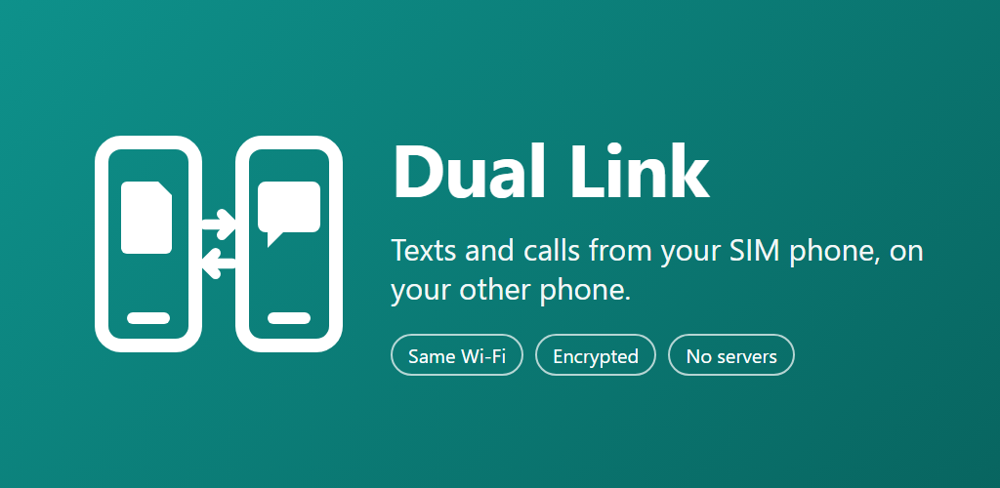
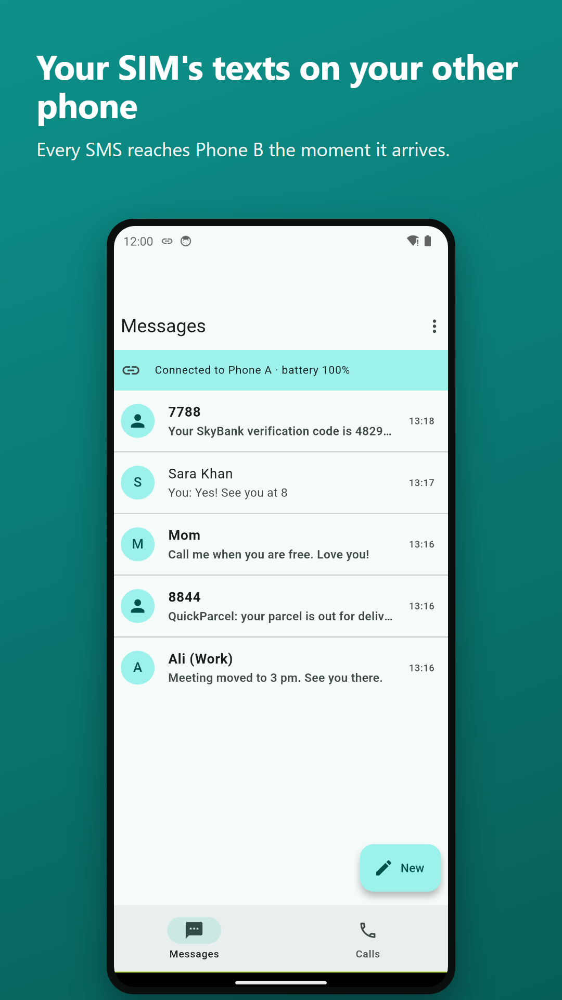
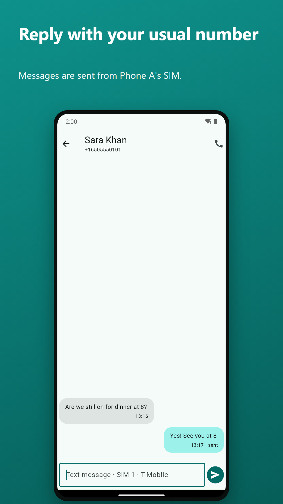
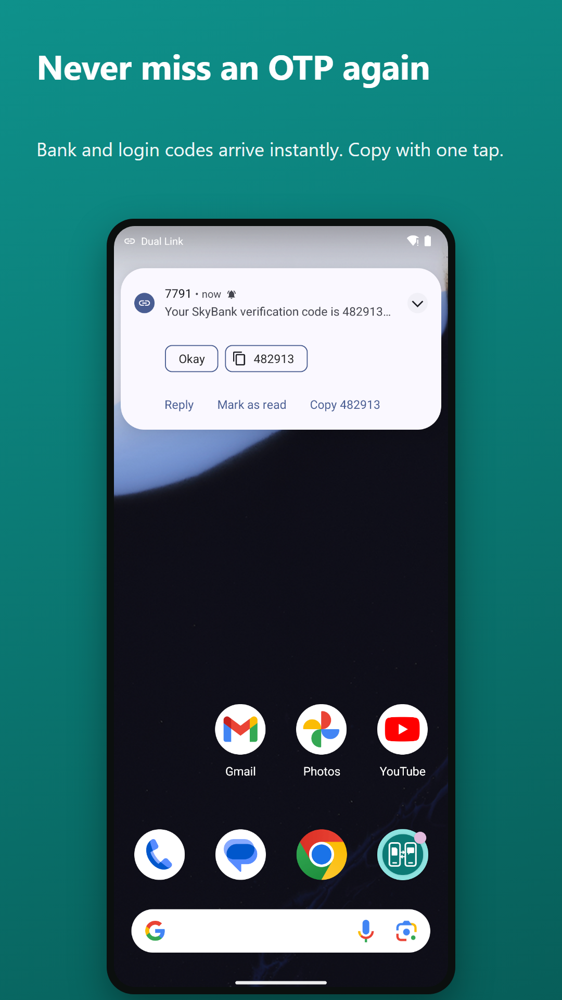
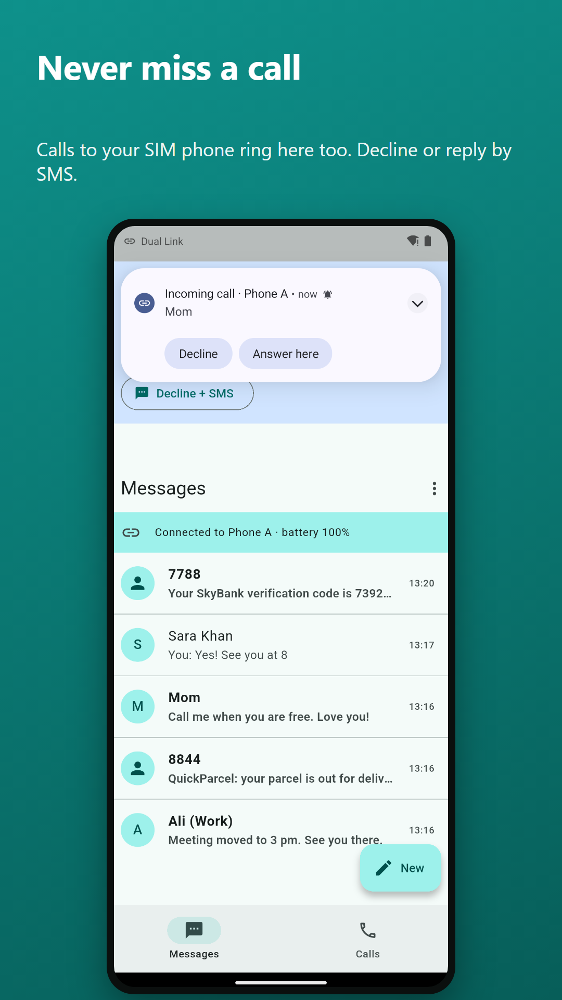
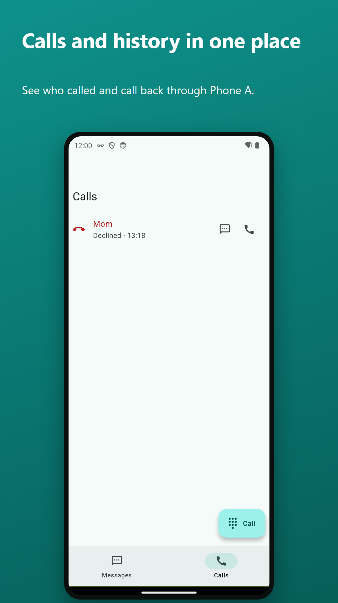
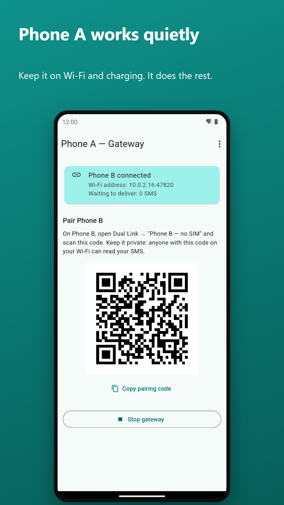
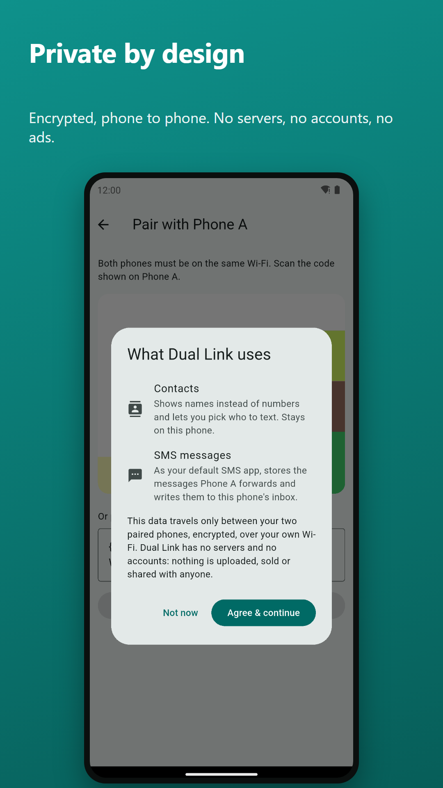
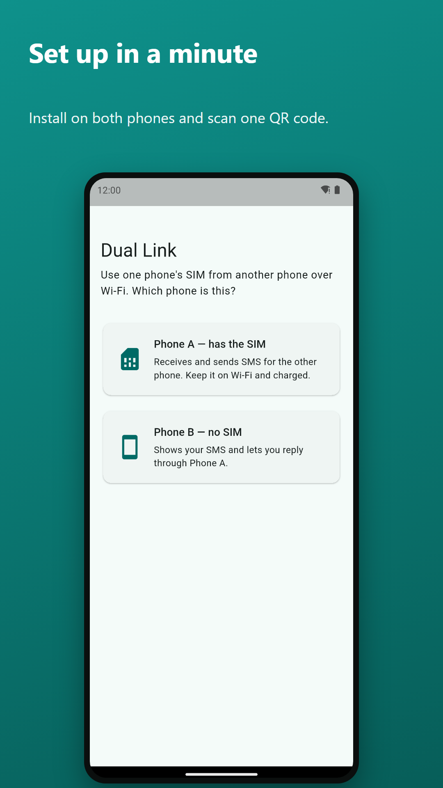

<p align="center">
  
</p>

<h1 align="center">Dual Link</h1>

<p align="center">
  <b>Texts and calls from your SIM phone, on your other phone.</b><br>
  Over your own Wi-Fi · end-to-end encrypted · no servers · no accounts
</p>

<p align="center">
  <a href="https://groups.google.com/g/dual-link-testers"><b>Join the testing group</b></a> ·
  <a href="https://ali1111111111.github.io/dual-link-site/">Website</a> ·
  <a href="https://youtu.be/5dDzYh4ltAI">Promo video</a> ·
  <a href="https://youtu.be/RPbOyae_HIw">Walkthrough</a> ·
  <a href="https://ali1111111111.github.io/dual-link-site/privacy.html">Privacy</a>
</p>

---

## Help us launch on Google Play

Dual Link is in **closed testing on Google Play**. To go public, Google needs at least **12 testers who keep the app installed for 14 days**. You can make that happen in two minutes:

1. **Join the group:** <https://groups.google.com/g/dual-link-testers> (one click, with your Google account)
2. **Become a tester:** <https://play.google.com/apps/testing/com.duallink.app>
3. **Install** Dual Link from Google Play and keep it for 14 days. One phone is enough to look around; two phones show the full magic.

Feedback and bug reports: open an issue here or email thetechfinn@gmail.com. Thank you!

---

## What it does

Carry one phone, keep both numbers in reach. Leave the phone with your SIM (**Phone A**) at home or in your bag, and use your everyday phone (**Phone B**) for its texts and calls.

<p align="center">
  
  
  
  
</p>
<p align="center">
  
  
  
  
</p>

- **Real-time SMS:** new texts on Phone A appear on Phone B instantly, with notifications, quick reply and one-tap code copy.
- **Reply with your usual number:** replies are sent from Phone A's SIM; choose the SIM on dual-SIM phones.
- **A real SMS app on Phone B:** default SMS app with conversations, contacts and its own Android inbox.
- **Calls:** incoming calls ring on Phone B; decline, end, or dial through Phone A; call history and missed calls.
- **Never lost, never duplicated:** messages are queued and acknowledged, even across Wi-Fi drops; reconnects by itself.
- **Light on battery:** an idle link uses under 1% CPU.

**Videos:** [30-second promo](https://youtu.be/5dDzYh4ltAI) · [setup and usage walkthrough](https://youtu.be/RPbOyae_HIw) (files in [`dual_link/play/assets/video`](dual_link/play/assets/video)).

## Privacy and security

- The two phones talk **directly over your local Wi-Fi**. There is no server, no account, no analytics and no ads.
- Pairing uses a QR code with a random 256-bit key. Every message is encrypted with **AES-256-GCM** and a per-session key, with replay and ordering protection.
- Keys are wrapped by the Android Keystore. Unpairing deletes stored messages and keys.
- The only third-party code that talks to the internet is Google ML Kit (the QR scanner), which sends anonymous diagnostics to Google.

Read the [privacy policy](https://ali1111111111.github.io/dual-link-site/privacy.html). Found a security issue? Please email thetechfinn@gmail.com instead of opening a public issue.

## How it works

```
Phone A (SIM)                                    Phone B (no SIM)
SMS / call events ──► GatewayService ══ Wi-Fi, AES-GCM ══► ClientService ──► SMS app UI
SIM ◄── send SMS / call control ◄══════════════════════════ replies, decline, dial
```

- `dual_link/lib/`: Flutter UI (screens only).
- `dual_link/android/app/src/main/kotlin/com/duallink/app/`: all background work in Kotlin (gateway and client services, protocol, SMS and call handling).
- `Protocol.kt` is plain JVM code with unit tests; `tool/uat.ps1` runs 48 end-to-end scenarios on two emulators (drops, retries, OTP bursts, calls, battery, memory).

## Build

Requirements: Flutter 3.47+, Android SDK, Java 17.

```bash
cd dual_link
flutter pub get
flutter build apk --release                                  # full build
flutter build appbundle --release -Pplay --dart-define=VOICE=false   # Google Play build
cd android && ./gradlew :app:testDebugUnitTest               # unit tests
```

Release signing reads `android/key.properties` (not in the repo); without it the build is signed with the debug key.

## Roadmap

- [x] Real-time SMS both ways, default SMS app, dual-SIM
- [x] Call alerts and control
- [ ] Public release on Google Play (closed testing now: [join](https://groups.google.com/g/dual-link-testers))
- [ ] **iPhone support** (iPhone as Phone B)
- [ ] Sync across different networks

## License

[GPL-3.0](LICENSE). You can use, study, share and improve Dual Link; derived apps must stay open source under the same license.

Made by **Ali Akbar** ([@ALI1111111111](https://github.com/ALI1111111111)).
